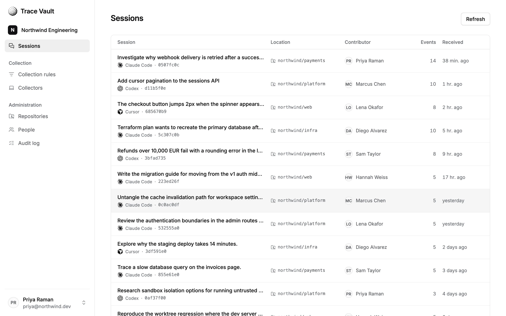
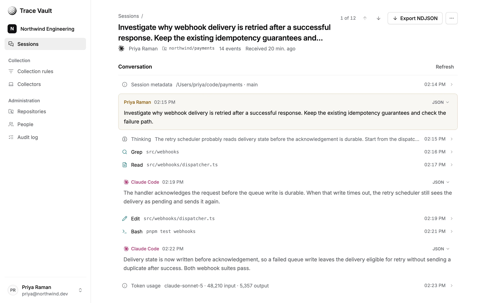
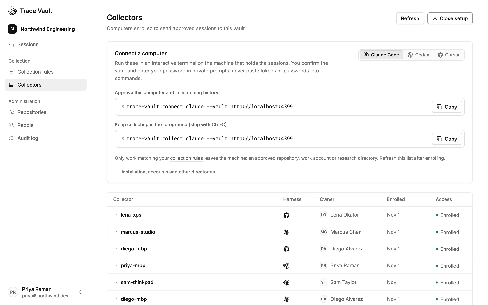
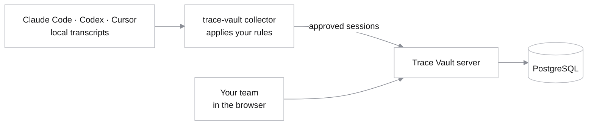

<p align="center">
  
</p>

<h1 align="center">Trace Vault</h1>

<p align="center">
  Every Claude Code, Codex and Cursor session your team runs,<br>
  in one archive on your own infrastructure.
</p>

<p align="center">
  <a href="https://github.com/Iteration-ai/trace-vault/actions/workflows/verify.yml"></a>
  <a href="https://www.npmjs.com/package/@useiteration/trace-vault-collector"></a>
  <a href="LICENSE"></a>
</p>

<p align="center">
  <a href="#quickstart">Quickstart</a> ·
  <a href="docs/setup.md">Self-hosting guide</a> ·
  <a href="docs/operations.md">Operations</a> ·
  <a href="packages/vault/README.md#http-boundary">HTTP API</a>
</p>



Trace Vault is a self-hosted archive for coding-agent sessions. A collector on
each developer's computer reads the transcripts that Claude Code, Codex and
Cursor already write, keeps the ones your rules approve and sends them to a
vault server you run next to PostgreSQL. Your team reads every session in the
browser, and any session exports as NDJSON. Nothing depends on an Iteration
account, a cloud service or an LLM API key.

## What you get

- **Collect** past and ongoing sessions from every computer, each tagged with its
  repository, contributor and agent.
- **Read** a session as the conversation it was: prompts, replies, reasoning and
  tool calls in source order, with the original JSON of every event one click away.
- **Decide** what leaves a machine. Only work in an approved repository, research
  directory or work account is sent; everything else stays local. Secrets are
  redacted before upload on a best-effort basis.
- **Own** the data in plain PostgreSQL that you back up and query yourself, with
  streaming NDJSON export and permanent deletion that collectors cannot undo.
- **Control** access with invitation-only accounts. Members see their own sessions,
  administrators see everyone's, collectors can be revoked at any time and every
  administrative change is recorded in an audit log.



## Quickstart

You need Docker with Compose v2.20 or later.

```sh
git clone https://github.com/Iteration-ai/trace-vault.git
cd trace-vault
cp packages/vault/.env.example .env
chmod 600 .env
```

Set `VAULT_DATABASE_PASSWORD` and `VAULT_BOOTSTRAP_TOKEN` in `.env` to two
separate values from `openssl rand -hex 32`, then start the vault:

```sh
docker compose --env-file .env up --build --detach --wait
```

Open <http://localhost:4310> on the Docker host, enter the bootstrap token and
create the first administrator. Then approve your company repositories and
invite your colleagues from the vault. To open it to your team, put it behind
your TLS reverse proxy and set `VAULT_PUBLIC_URL` to its HTTPS address; the
[self-hosting guide](docs/setup.md) covers this and running without Docker.

## Connect a computer

Each developer installs the collector (Node.js 22.22 or later) and connects it
to the vault:

```sh
npm install --global @useiteration/trace-vault-collector --ignore-scripts
trace-vault connect claude --vault https://vault.example.com
trace-vault collect claude --vault https://vault.example.com
```

`connect` signs in through private prompts, shows which work your rules approve
and imports the matching history. `collect` keeps sending new sessions until you
stop it. Use `codex` or `cursor` for the other agents. The vault's Collectors
page shows these commands with your vault's address filled in.



## How it works



The collector runs where the transcripts live and matches each session against
the vault's rules: a company repository (read from Git), an approved directory,
or, for terminal Claude Code 2.1.282, an approved work account. Records that
match nothing are never uploaded. The server stores sessions in PostgreSQL,
signs people in with their own passwords and keeps collector credentials
separate from read access.

Before you deploy, know that:

- Redaction is best effort, so treat the archive and its backups as sensitive.
- Approving a repository or directory includes its history, and it does not prove
  which account produced that history.
- Trace Vault has no search, SSO or hosted offering.
- Anonymous pulls of the published container image are blocked for now, so the
  quickstart builds the server from source.

## Repository

| Package | What it is |
| --- | --- |
| [`packages/vault`](packages/vault/README.md) | Server and web app: authentication, permissions, storage and the HTTP API |
| [`packages/vault-collector`](packages/vault-collector/README.md) | The `trace-vault` command, published to npm |
| [`packages/cli`](packages/cli/README.md) | `iteration-trace-collector`, the collection library behind it |
| `packages/trace-contracts` | Event, source and capture contracts shared by both sides |
| [`packages/trace-postgres`](packages/trace-postgres/README.md) | The PostgreSQL storage engine for traces |

The [self-hosting guide](docs/setup.md) also covers building from source and
verification, and the [operations guide](docs/operations.md) covers backups,
upgrades and recovery. Read [CONTRIBUTING.md](CONTRIBUTING.md) before opening a
pull request and [SECURITY.md](SECURITY.md) before reporting a vulnerability.

## License

[Apache-2.0](LICENSE). Built by [Iteration](https://github.com/Iteration-ai).
