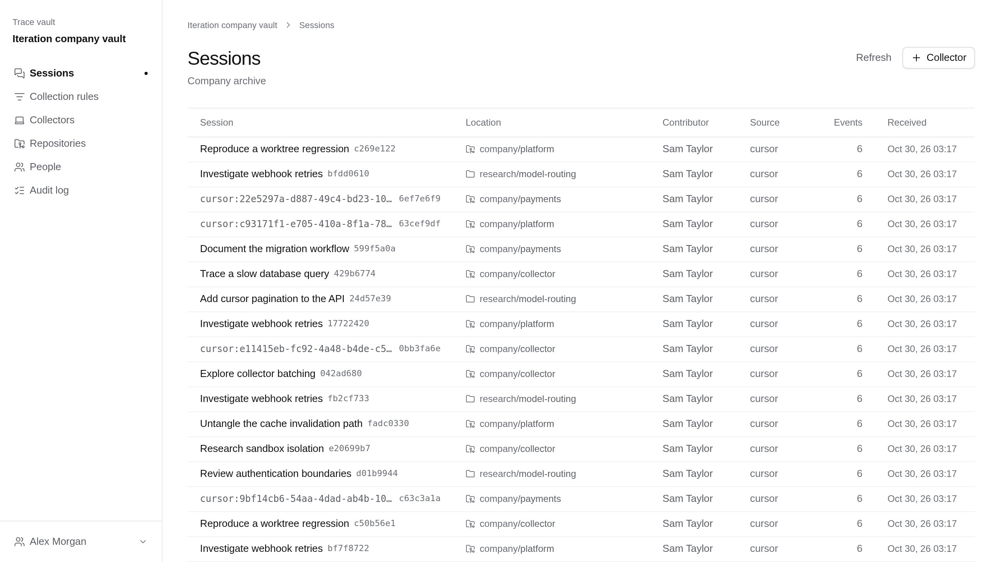
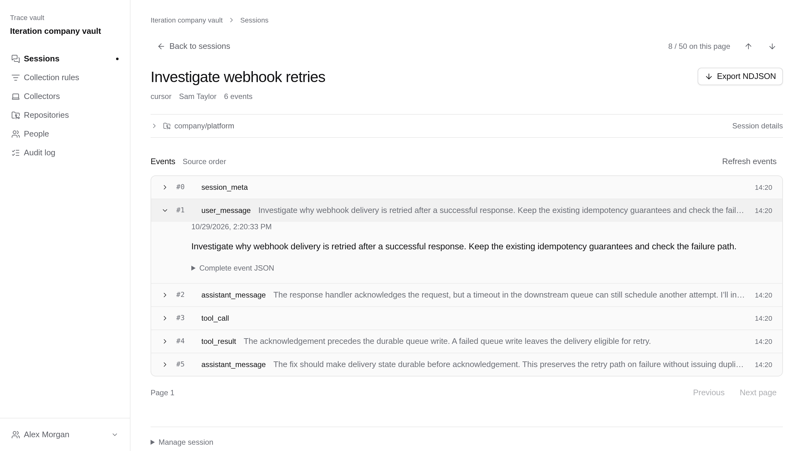

<h1 align="center">Trace Vault</h1>

<p align="center"><strong>Your coding-agent traces. Your infrastructure.</strong></p>
<p align="center">Claude Code · Codex · Cursor<br>Self-hosted · Apache-2.0 · No cloud account or LLM required</p>



Collect, browse and export your coding-agent sessions in one archive you control.

- **Keep the history.** Import existing sessions and collect new ones.
- **Choose what leaves the machine.** Explicit capture rules; unmatched records stay local.
- **Own the archive.** PostgreSQL storage, member/admin access and NDJSON exports.

<details>
<summary>Inside a session</summary>



</details>

## Get started

Requires Docker with Compose v2.20+.

```sh
git clone https://github.com/Iteration-ai/trace-vault.git
cd trace-vault
cp packages/vault/.env.example .env
chmod 600 .env
```

Set `VAULT_DATABASE_PASSWORD` and `VAULT_BOOTSTRAP_TOKEN` in `.env`, generating
each independently with `openssl rand -hex 32`. Then:

```sh
docker compose --env-file .env up --build --detach --wait
```

Open **http://localhost:4310** on the Docker host, create your admin with the
bootstrap token, then [connect a collector](docs/setup.md#build-the-collector).

[Full setup & capture limitations](docs/setup.md) · [Backups & recovery](docs/operations.md) · [Contributing](CONTRIBUTING.md) · [Security](SECURITY.md)

Built by [Iteration](https://github.com/Iteration-ai). [Apache-2.0](LICENSE).
